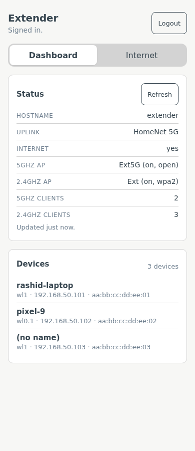
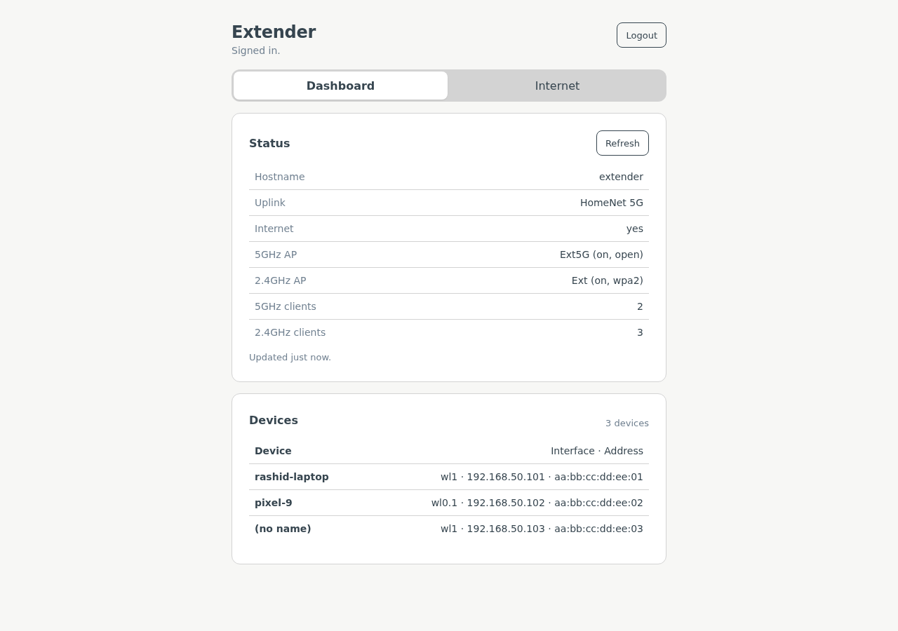

# Extender for FiberHome HG6145D2

Turn a locked-down FiberHome HG6145D2 ONT into a dual-band Wi-Fi extender: NAT, DHCP, and a phone-sized control page, using only what the firmware already ships.

No packages, no build step, no external assets. Shell is BusyBox `sh`.

| Phone (390px) | Desktop (1280px) |
|---|---|
|  |  |

## What it does

- Joins an upstream Wi-Fi as a client on `wl0` and gets an address with `udhcpc`.
- Rebroadcasts on 2.4GHz (`wl0.1`) and 5GHz (`wl1`).
- Bridges `wl0.1`, `wl1` and `lan0`–`lan3` into `br0`, serves DHCP with `udhcpd`, NATs with `iptables`.
- Serves a web page for status, clients, uplink scan/connect, SSIDs, WPA2 password, hostname, MAC and AP on/off.
- Keeps settings across a reboot in `/fhconf/mytools`.

## How it works

```text
             Uplink Wi-Fi
                  |
        wl0 (client) | udhcpc
                  |
     FiberHome HG6145D2
   iptables NAT + br0 + udhcpd
        /                    \
 wl0.1  "Ext"          wl1  "Ext5G"
 2.4GHz, uplink ch     5GHz
```

`wl0.1` is a virtual interface on the `wl0` radio, so it has to follow the uplink channel. `wl1` picks its own 5GHz channel from neighbouring signal levels.

## Requirements

- FiberHome HG6145D2 (Broadcom, Linux 4.1.52 armv7l, BusyBox 1.30.1) with a root shell.
- Or a similar Broadcom box with `wl`, `wpa_supplicant`, `wpa_cli`, `udhcpc`, `udhcpd`, `brctl`, `iptables`.
- A writable `/fhconf`. It is the only persistent path on this firmware.

## Install

Place these files on the router:

| From the repo | On the router |
|---|---|
| `extender.sh` | `/fhconf/mytools/extender.sh` |
| `web/start.sh` | `/fhconf/mytools/web/start.sh` |
| `web/www/` | `/fhconf/mytools/web/www/` |

Then run, from the router shell:

```sh
sh /fhconf/mytools/extender.sh      # scan, pick the uplink, enter its password
sh /fhconf/mytools/web/start.sh     # first run asks for the page password
```

Open `http://<br0-ip>/` (usually `http://192.168.50.1/`) and sign in as `admin`.

`start.sh` writes `passwd`, `httpd.conf` and `httpd.pid` next to itself. The first two are mode 600. To reset the page password, delete `passwd` and run `start.sh` again.

## Commands

| Command | Action |
|---|---|
| `sh extender.sh` | Scan and connect to an uplink |
| `sh extender.sh -r` | List saved networks, choose one |
| `sh extender.sh -r 2` | Reconnect to saved network 2 |
| `sh extender.sh -r -d 2` | Delete saved network 2 |
| `sh extender.sh -s` | Status: uplink, both APs, clients |
| `sh extender.sh -k` | Stop and restore default routing |
| `sh extender.sh -h` | Help |

## Web page

| Card | What it does |
|---|---|
| Status | Hostname, uplink, internet, both APs, client counts. Refresh button and 20s auto-refresh. |
| Devices | Client name, interface, IP, MAC. Names come from the DHCP hostname. |
| Connect to uplink | Scan nearby Wi-Fi or pick a saved network, then connect. |
| Test connection | Ping the gateway and the internet. |
| WiFi AP On/Off | Toggle `wl0.1` and `wl1` live. Runtime only. |
| SSID | Rename either AP, set the 2.4GHz WPA2 password. Restore returns names to defaults. |
| Hostname & MAC | Router hostname and `wl1` MAC. Restore returns them to defaults. |

Restore opens a command palette. Closing it changes nothing.

## Where settings live

| File | Holds | Survives reboot |
|---|---|---|
| `/fhconf/mytools/passwords` | Uplink networks (SSID, security, password) | yes |
| `/fhconf/mytools/ssid.conf` | AP names | yes |
| `/fhconf/mytools/mac.conf` | Custom MACs | yes |
| `/fhconf/mytools/wpa.conf` | 2.4GHz WPA2 password | yes |
| `/tmp/hostname.conf` | Router hostname | no |
| `/tmp/ext_ap_state` | AP on/off state | no |
| `/tmp/udhcpd.leases` | DHCP leases | no |

## Known limits

- **`wl0` cannot take a custom MAC.** The uplink rejects it at Layer 2, so the factory MAC is used while reconnecting. A custom MAC applies to `wl1` only.
- **`wl0.1` has no independent MAC.** It shares the `wl0` radio and the uplink channel.
- **The APs are open by default.** The 2.4GHz AP can take a WPA2 password from the page; `wl1` stays open.
- **The page is plain HTTP.** The session cookie can be sniffed by anyone on the same Wi-Fi. This is a home tool, not a hardened appliance. It listens on `br0` only, never on the uplink.
- **Sessions end after 5 idle minutes.** Three wrong logins trigger a 60-second lockout.
- **AP on/off state is not saved.** It resets when the extender restarts.


## Roadmap

- **Setup mode.** Boot to a 2.4GHz AP before any uplink exists, then configure everything from a phone. Blocked on one hardware test: whether `wl0.1` beacons while `wl0` is unassociated.
- **One boot script.** Start the page and the extender together, with an ESP32 that breaks boot and types one line.
- **`start.sh` retry loop.** Let it launch before `br0` exists and bind when the bridge appears.

## License

MIT. See [LICENSE](LICENSE).
